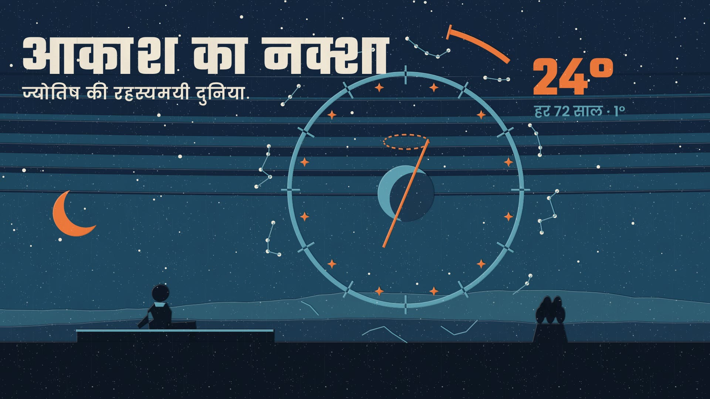

<div align="center">

# Hi, I'm Kshitija 👋

**Learning, building and making films in code with Claude.**

</div>

## 🙋 About me

- 🌱 I'm currently learning: *(add what you're learning)*
- 💡 I'm interested in: animation, creative coding and AI tools
- 📫 How to reach me: *(add a link, e.g. LinkedIn)*

## 🎬 What I'm exploring: Lemo-Opuscar

[**Lemo-Opuscar**](https://github.com/lemomo-ai/lemo-opuscar) is a library of **66 film styles made entirely in code**,
from watercolor and ukiyo-e to pixel RPG, chalkboard and LiDAR survey.
A coding agent like Claude picks a style, then directs, draws, scores and mixes a short film about any topic.

<a href="https://lemomo-ai.github.io/lemo-opuscar/"></a>

<table>
<tr>
<td width="33%" valign="top"><br><b>Chalkboard</b></td>
<td width="33%" valign="top"><br><b>Transit Map</b></td>
<td width="33%" valign="top"><br><b>Memphis Diorama</b></td>
</tr>
</table>

▶ [Watch the gallery](https://lemomo-ai.github.io/lemo-opuscar/) · 📚 [All styles](https://github.com/lemomo-ai/lemo-opuscar/blob/main/styles/README.md)

### Use it with Claude

```sh
claude plugin marketplace add lemomo-ai/lemo-opuscar
claude plugin install lemo-opuscar@lemolab
```

Then ask, for example:

> Make a 45-second film in the **watercolor** style about my hometown. Warm female narrator.

## 🎥 My films

Films I make with Lemo-Opuscar will appear here.

| Film | Style | Link |
|---|---|---|
| **आकाश का नक्शा** · The Map of the Sky (Hindi, 2:06): the mysterious world of astrology, from Babylon to the 24° drift of the sky | Silkscreen Travel Poster | [▶ Watch](films/aakash-ka-naksha/aakash-ka-naksha.mp4) · [About](films/aakash-ka-naksha/) |
| **Astroverse · राशियों की कहानी**: 12 episodes, one per rashi (Hindi, 1:38 each, Shorts and 16:9) | Silkscreen Travel Poster | [▶ All 12](astroverse-rashi-series/) |
| **प्राचीन रसोई · The Ancient Kitchen** (Kathaverse): the world's oldest foods, Ep 1 दुनिया की पहली रोटी (Hindi, 1:53, Shorts and 16:9) | Tablet Sketch Explainer | [▶ Series](pracheen-rasoi-series/) |
| **दादी की रसोई का टूर** (Kathaverse): Lotu-ram the brass lota tours a 100-year-old Indian kitchen where every tool is alive (Hindi, 1:50, Shorts and 16:9) | 1930s Rubber Hose Cartoon | [▶ Watch](dadi-ki-rasoi-tour/) |

<a href="films/aakash-ka-naksha/"></a>

---

<sub>Lemo-Opuscar and its images are by **[LemoLab](https://github.com/lemomo-ai/lemo-opuscar)**.
Code and docs: MIT. Demo films and stills: [CC BY 4.0](https://creativecommons.org/licenses/by/4.0/), shown here unchanged.</sub>
