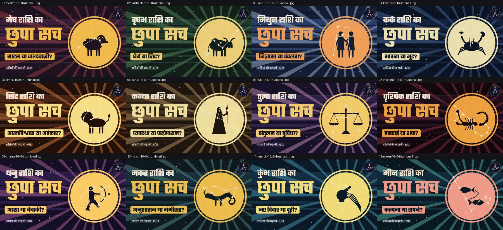

# Astroverse · राशियों की कहानी (12 episodes)

One video per rashi, in Hindi, in the Silkscreen Travel Poster style. Each video runs **1:38**: the Astroverse intro (5 s), then the thumbnail card (1.5 s), then a 91 s film.

Each film has five parts: the rashi's sky and constellation; its element, ruling planet and Sun-entry date; a story (sankranti, nakshatra or myth); four trait cards, shown as traditional belief; and a "comment and follow Astroverse" ending that names the next rashi.

| # | Rashi | Shorts (9:16) | Regular (16:9) | Thumbnail | Subtitles |
|---|---|---|---|---|---|
| 1 | मेष (Aries) | [▶ Short](01-mesh-shorts.mp4) | [▶ Video](01-mesh-16x9.mp4) | [16:9](01-mesh-16x9-thumbnail.jpg) · [9:16](01-mesh-shorts-thumbnail.jpg) | [.srt](01-mesh.srt) |
| 2 | वृषभ (Taurus) | [▶ Short](02-vrishabh-shorts.mp4) | [▶ Video](02-vrishabh-16x9.mp4) | [16:9](02-vrishabh-16x9-thumbnail.jpg) · [9:16](02-vrishabh-shorts-thumbnail.jpg) | [.srt](02-vrishabh.srt) |
| 3 | मिथुन (Gemini) | [▶ Short](03-mithun-shorts.mp4) | [▶ Video](03-mithun-16x9.mp4) | [16:9](03-mithun-16x9-thumbnail.jpg) · [9:16](03-mithun-shorts-thumbnail.jpg) | [.srt](03-mithun.srt) |
| 4 | कर्क (Cancer) | [▶ Short](04-kark-shorts.mp4) | [▶ Video](04-kark-16x9.mp4) | [16:9](04-kark-16x9-thumbnail.jpg) · [9:16](04-kark-shorts-thumbnail.jpg) | [.srt](04-kark.srt) |
| 5 | सिंह (Leo) | [▶ Short](05-simha-shorts.mp4) | [▶ Video](05-simha-16x9.mp4) | [16:9](05-simha-16x9-thumbnail.jpg) · [9:16](05-simha-shorts-thumbnail.jpg) | [.srt](05-simha.srt) |
| 6 | कन्या (Virgo) | [▶ Short](06-kanya-shorts.mp4) | [▶ Video](06-kanya-16x9.mp4) | [16:9](06-kanya-16x9-thumbnail.jpg) · [9:16](06-kanya-shorts-thumbnail.jpg) | [.srt](06-kanya.srt) |
| 7 | तुला (Libra) | [▶ Short](07-tula-shorts.mp4) | [▶ Video](07-tula-16x9.mp4) | [16:9](07-tula-16x9-thumbnail.jpg) · [9:16](07-tula-shorts-thumbnail.jpg) | [.srt](07-tula.srt) |
| 8 | वृश्चिक (Scorpio) | [▶ Short](08-vrishchik-shorts.mp4) | [▶ Video](08-vrishchik-16x9.mp4) | [16:9](08-vrishchik-16x9-thumbnail.jpg) · [9:16](08-vrishchik-shorts-thumbnail.jpg) | [.srt](08-vrishchik.srt) |
| 9 | धनु (Sagittarius) | [▶ Short](09-dhanu-shorts.mp4) | [▶ Video](09-dhanu-16x9.mp4) | [16:9](09-dhanu-16x9-thumbnail.jpg) · [9:16](09-dhanu-shorts-thumbnail.jpg) | [.srt](09-dhanu.srt) |
| 10 | मकर (Capricorn) | [▶ Short](10-makar-shorts.mp4) | [▶ Video](10-makar-16x9.mp4) | [16:9](10-makar-16x9-thumbnail.jpg) · [9:16](10-makar-shorts-thumbnail.jpg) | [.srt](10-makar.srt) |
| 11 | कुंभ (Aquarius) | [▶ Short](11-kumbh-shorts.mp4) | [▶ Video](11-kumbh-16x9.mp4) | [16:9](11-kumbh-16x9-thumbnail.jpg) · [9:16](11-kumbh-shorts-thumbnail.jpg) | [.srt](11-kumbh.srt) |
| 12 | मीन (Pisces) | [▶ Short](12-meen-shorts.mp4) | [▶ Video](12-meen-16x9.mp4) | [16:9](12-meen-16x9-thumbnail.jpg) · [9:16](12-meen-shorts-thumbnail.jpg) | [.srt](12-meen.srt) |

**Uploading:** titles, descriptions, hashtags and pinned comments for every episode are in [YOUTUBE.md](YOUTUBE.md). For a Short, pick the thumbnail-card frame (around 5.5 s) as its cover. For a regular video, upload the matching `*-16x9-thumbnail.jpg`.

Facts and sources: [source/FACTS.md](source/FACTS.md) · Credits: [source/CREDITS](source/CREDITS) · Rebuild: copy `source/` into a Lemo-Opuscar clone as `films/kathaverse/`, add `intro.mp4` and `logo_full.jpg`, then run `sh films/kathaverse/build.sh`.
