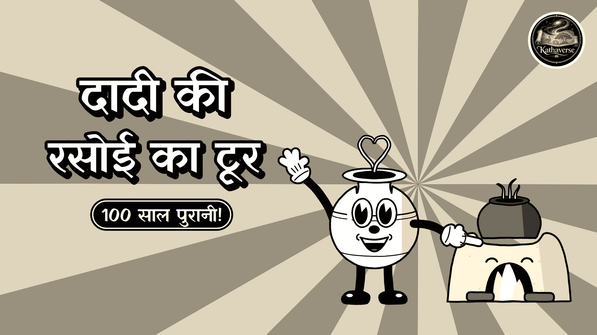

# दादी की रसोई का टूर · Grandma's Kitchen Tour (Kathaverse)

A Hindi cartoon for **Kathaverse** in the **1930s Rubber Hose Cartoon** style of [Lemo-Opuscar](https://github.com/lemomo-ai/lemo-opuscar):
hand-inked black-and-white characters with rubber-hose limbs, white gloves and pie eyes; everything breathes on the beat of a hot jazz band; a worn 35 mm print with flicker, scratches and dust, in a warm sepia tone.

**लोटूराम** (Lotu-ram), a brass लोटा with rubber-hose arms and big shoes, is the MC. He guides us through a kitchen of a hundred years ago, where every tool is alive and does its job to the music:

| Station | The tool | The gag |
|---|---|---|
| 1 | **चूल्हा** + फुंकनी | Lotu blows the pipe like a trumpet; the fire grows on every note |
| 2 | **सिल-बट्टा** | the roller stone rolls on the beat; fresh chutney appears |
| 3 | **ओखली-मूसल** | the pestle pounds like a bass drum; husk flies off the grain |
| 4 | **चक्की** | the hand mill spins and pours flour, and gets dizzy |
| 5 | **मथानी** | pulling the rope is a trombone smear; butter pops up |
| 6 | **सूप** | grain is tossed on the beat; the light chaff blows away |
| 7 | **मटका** | water seeps through the clay and evaporates, so the pot stays cool |

Finale: "बिना बिजली, बिना मशीन, फिर भी कमाल!" The whole kitchen dances, then Lotu drags the Kathaverse end card over the scene.

| Format | Video | Thumbnail |
|---|---|---|
| Regular (16:9, 4:3 film gate) | [▶ Video](dadi-ki-rasoi-tour-16x9.mp4) | [16:9](dadi-ki-rasoi-tour-16x9-thumbnail.jpg) |
| Short (9:16, 3:4 film gate) | [▶ Short](dadi-ki-rasoi-tour-shorts.mp4) | [9:16](dadi-ki-rasoi-tour-shorts-thumbnail.jpg) |

Hindi subtitles: [dadi-ki-rasoi-tour.srt](dadi-ki-rasoi-tour.srt) · Upload kit: [YOUTUBE.md](YOUTUBE.md)

Channel format, as in the other Kathaverse videos: Kathaverse intro (5 s) → thumbnail card (1.5 s) → the film, with the Kathaverse logo in the corner (in the black border outside the film gate) and an end card with the logo, a comment question and "फॉलो करें · Kathaverse".

Plan: [source/TREATMENT.md](source/TREATMENT.md) · Credits: [source/CREDITS](source/CREDITS) · Rebuild: copy `source/` into a Lemo-Opuscar clone as `films/kv-rasoi/` and run `sh films/kv-rasoi/build.sh`.
