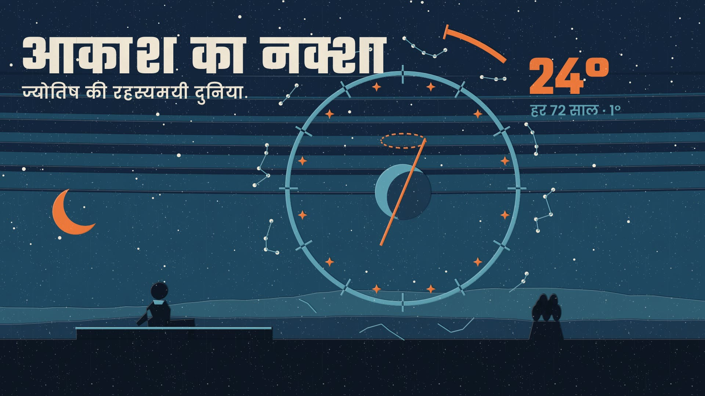

# आकाश का नक्शा · The Map of the Sky

A 2-minute Hindi film about the mysterious world of astrology, made in the **Silkscreen Travel Poster** style of [Lemo-Opuscar](https://github.com/lemomo-ai/lemo-opuscar). Every frame, note and sound is written in code.

▶ **[Watch / download the film (MP4, 1080p, 2:06)](aakash-ka-naksha.mp4)** · Hindi subtitles: [aakash-ka-naksha.srt](aakash-ka-naksha.srt)

**The story:** for thousands of years people have asked whether the stars write our fate. The film travels from Babylon (the oldest known horoscope, 410 BCE) to Alexandria (Ptolemy), then to Jaipur (27 nakshatras, the giant stone sundial of 1734) and a 1930 London newspaper. Then comes the twist: the Earth wobbles like a spinning top, so the sky has drifted about 24° from the old signs. That drift is why Indian and Western signs differ. Scientific tests have not found astrology's predictions better than chance, but the effort to read the sky gave us calendars, mathematics and astronomy.

- `TREATMENT.md`: the plan (structure, shots, music cues)
- `FACTS.md`: a source for every fact in the film
- `CREDITS`: fonts, voice engine and samples, with their licences

## Rebuild it
Copy this folder into a clone of Lemo-Opuscar as `films/aakash-ka-naksha/`, install its tools (`sh plugin/skills/lemo-opuscar/scripts/setup.sh deps voice music`, `sh tools/fetch.sh instruments vcsl`) and run `sh films/aakash-ka-naksha/build.sh`.
