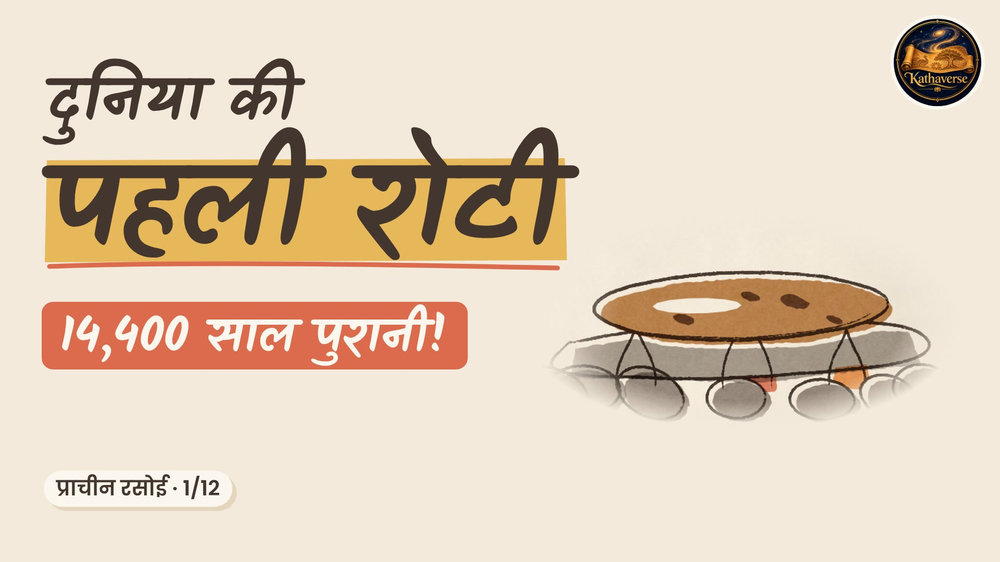

# प्राचीन रसोई · The Ancient Kitchen (Kathaverse)

The world's oldest foods, one sketch at a time. A Hindi series for **Kathaverse**, in the **Tablet Sketch Explainer** style of
[Lemo-Opuscar](https://github.com/lemomo-ai/lemo-opuscar): pencil lines go down first, colour blocks follow, and the canvas is panned and pinched like a tablet.

Every episode follows the channel format: **Kathaverse intro (5 s)** → **thumbnail card (1.5 s)** → the film, with the Kathaverse logo in the corner and a **follow end card** (comment question, "फॉलो करें · Kathaverse", the logo, next episode).
Each is delivered in 16:9 and as a Short (9:16), with thumbnails for both and Hindi subtitles.

| # | Episode | Shorts (9:16) | Regular (16:9) | Thumbnail | Subtitles |
|---|---|---|---|---|---|
| 1 | **दुनिया की पहली रोटी** · Jordan, 14,400 years ago | [▶ Short](01-pehli-roti-shorts.mp4) | [▶ Video](01-pehli-roti-16x9.mp4) | [16:9](01-pehli-roti-16x9-thumbnail.jpg) · [9:16](01-pehli-roti-shorts-thumbnail.jpg) | [.srt](01-pehli-roti.srt) |
| 2 | 4,500 साल पुरानी करी · Harappa | coming next | | | |
| 3 | हड़प्पा के लड्डू · Binjor, Rajasthan | | | | |
| 4 | पहली लिखी हुई रेसिपी · Mesopotamia | | | | |
| 5 | बीयर से बनी सभ्यता · Sumer | | | | |
| 6 | 4,000 साल पुराने नूडल्स · Lajia, China | | | | |
| 7 | चॉकलेट: देवताओं का पेय · Ecuador → Maya | | | | |
| 8 | मक्के का जादू · Mexico | | | | |
| 9 | रोम की मछली वाली चटनी · Pompeii | | | | |
| 10 | पिरामिडों का शहद और पनीर · Egypt | | | | |
| 11 | सम्राट की चाय · Han China | | | | |
| 12 | सुशी की असली कहानी · Southeast Asia → Japan | | | | |

**Ep 1, the story:** everyone assumes farming came first and bread after. But 14,400 years ago, Natufian hunter-gatherers at Shubayqa in Jordan's Black Desert ground wild einkorn and club-rush tubers, kneaded the flour and baked flatbread on the stones of their fireplace, at least 4,000 years before farming. The page ends with the arrow reversed: रोटी → खेती?

**Uploading:** titles, descriptions, tags and pinned comments are in [YOUTUBE.md](YOUTUBE.md). For a Short, pick the thumbnail-card frame (~5.5 s) as the cover.

Facts and sources: [source/FACTS.md](source/FACTS.md) · Plan: [source/TREATMENT.md](source/TREATMENT.md) · Credits: [source/CREDITS](source/CREDITS) · Rebuild: copy `source/` into a Lemo-Opuscar clone as `films/kv-food/`, then run `sh films/kv-food/build.sh` (it regenerates the voice and the intro from `logo_src.png`).
